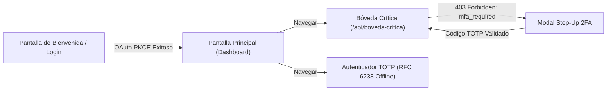

# PLAN ARQUITECTÓNICO: ARQUITECTURA Y ESTRUCTURA BASE
**Código:** PLAN-001 | **Especificación:** SPEC-001 | **Estado:** Aprobado

---

## 1. DISEÑO ARQUITECTÓNICO

El sistema se organiza bajo una arquitectura limpia y modular dividida en dos subproyectos independientes:

```text
SeguridadMovil/
├── mobile-app/              <- React Native (Expo SDK 58)
│   ├── src/
│   │   ├── navigation/      <- Stack de navegación (Login, Vault, Authenticator)
│   │   ├── screens/         <- Vistas de usuario
│   │   ├── components/      <- Componentes UI reutilizables
│   │   ├── hooks/           <- Custom Hooks para estado y flujos
│   │   ├── services/        <- Cliente HTTP, SecureStore, API calls
│   │   ├── crypto/          <- Implementación TOTP RFC 6238 y PKCE
│   │   ├── types/           <- Interfaces y tipos TypeScript
│   │   └── config/          <- Variables de configuración y endpoints
│   ├── app.json
│   ├── package.json
│   └── tsconfig.json
│
├── backend-auth/            <- Node.js + Express (TypeScript)
│   ├── src/
│   │   ├── controllers/     <- Controladores de rutas
│   │   ├── middleware/      <- Auth middleware, anti-replay, error handler
│   │   ├── services/        <- Token service, TOTP validation, Vault service
│   │   ├── database/        <- SQLite connection y repositorios
│   │   ├── types/           <- Modelos e interfaces
│   │   ├── app.ts           <- Configuración de Express
│   │   └── server.ts        <- Entrypoint del servidor HTTP
│   ├── package.json
│   └── tsconfig.json
│
├── .specify/                <- Documentación y especificaciones SDD
├── docs/                    <- Documentos de arquitectura y estado
└── README.md                <- Guía de despliegue y sustentación
```

---

## 2. FLUJO DE NAVEGACIÓN Y ESTADO DE LA APP MÓVIL



---

## 3. CONTRATOS DE DATOS BASE

```typescript
// Shared Types / DTOs
export interface HealthResponse {
  status: 'ok';
  service: 'backend-auth';
  timestamp: string;
}

export interface ApiErrorResponse {
  error: string;
  message?: string;
  step_up_token?: string; // Cuando error === 'mfa_required'
}

export interface VaultData {
  secretData: string;
  classification: 'TOP_SECRET';
  accessedAt: string;
}
```

---

## 4. ESTRATEGIA DE VERIFICACIÓN
1. **Compilación estricta:** `npx tsc --noEmit` en ambos proyectos sin errores de tipado.
2. **Arranque del servidor backend:** Probar endpoint `GET /health` usando `curl` o fetch.
3. **Arranque de la app móvil:** Verificar que los componentes de pantalla y navegación carguen en Expo.

