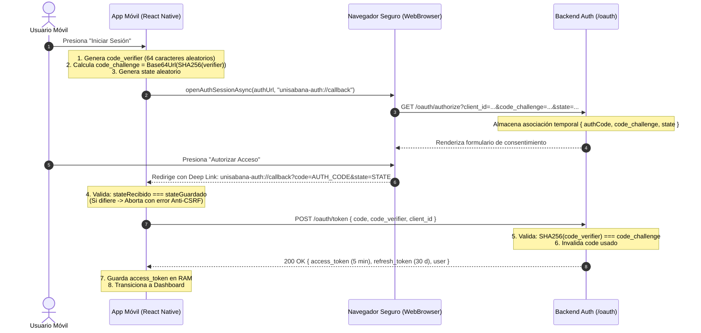

# PLAN ARQUITECTÓNICO: OAUTH 2.0 CON PKCE & DEEP LINKING
**Código:** PLAN-002 | **Especificación:** SPEC-002 | **Estado:** Aprobado

---

## 1. DISEÑO ARQUITECTÓNICO Y FLUJO PKCE



---

## 2. COMPONENTES Y ARCHIVOS INVOLUCRADOS

### En `mobile-app`:
- `app.json`: Registrar el esquema `"scheme": "unisabana-auth"`.
- `src/crypto/pkce.ts`: Funciones `generateCodeVerifier()`, `generateCodeChallenge()`, `generateRandomState()`.
- `src/services/authService.ts`: Orquestador del flujo OAuth:
  - Invoca `WebBrowser.openAuthSessionAsync`.
  - Parsea la URL de respuesta.
  - Valida el `state`.
  - Llama a `POST /oauth/token`.
- `src/screens/LoginScreen.tsx`: Conectar botón con `authService.loginWithOAuth()`.

### En `backend-auth`:
- `src/services/oauthService.ts`: Almacén y validación de `authorization_codes`, verificación matemática de PKCE (`SHA256(code_verifier) === code_challenge`).
- `src/controllers/oauthController.ts`:
  - `GET /oauth/authorize`: Vista HTML de autorización y redirección deep link.
  - `POST /oauth/token`: Intercambio seguro y emisión de tokens.
- `src/routes/oauthRoutes.ts`: Enrutador de OAuth.
- `src/app.ts`: Montar rutas en `/oauth`.

---

## 3. CONTRATOS DE DATOS

```typescript
// Intercambio de tokens: Request
export interface TokenExchangeRequest {
  grant_type: 'authorization_code';
  code: string;
  code_verifier: string;
  client_id: string;
  redirect_uri: string;
}

// Intercambio de tokens: Response
export interface TokenResponse {
  access_token: string;
  token_type: 'Bearer';
  expires_in: 300; // 5 minutos exactos (300 segundos)
  refresh_token: string;
  scope: string;
  user: {
    id: string;
    email: string;
    name: string;
  };
}
```

---

## 4. ESTRATEGIA DE PRUEBAS
1. **Prueba Unitaria Criptográfica:** Verificar que `code_verifier` tenga entre 43 y 128 caracteres y que `code_challenge` sea un hash SHA-256 en Base64URL sin relleno (`=`).
2. **Prueba Anti-CSRF:** Simular retorno con `state` adulterado y comprobar que la app aborte el intercambio.
3. **Prueba Anti-Tampering PKCE en Backend:** Enviar un `code_verifier` que no corresponda al `code_challenge` y verificar que el backend responda `400 Bad Request: invalid_grant`.
4. **Prueba de Flujo Completo E2E:** Login con navegador del sistema, redirección exitosa a la app y recepción de tokens con 5 minutos de expiración.

