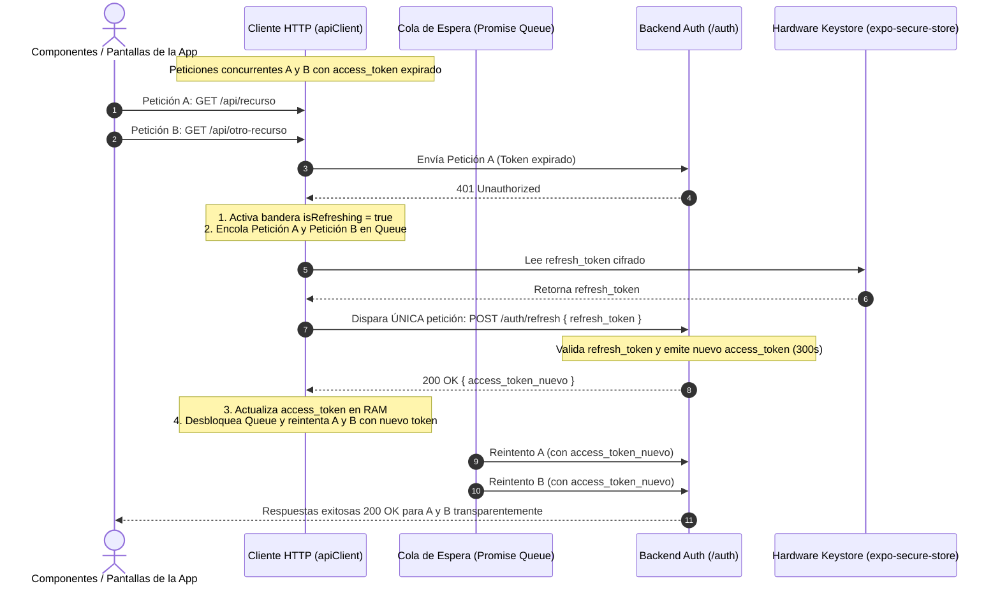

# PLAN ARQUITECTÓNICO: ALMACENAMIENTO SEGURO Y SILENT REFRESH QUEUE
**Código:** PLAN-003 | **Especificación:** SPEC-003 | **Estado:** Aprobado

---

## 1. DISEÑO ARQUITECTÓNICO: SEPARACIÓN DE MEMORIA Y COLA SILENCIOSA

---

## 2. COMPONENTES Y ARCHIVOS INVOLUCRADOS

### En `mobile-app`:
- Instalar `expo-secure-store` vía `npx expo install expo-secure-store`.
- `src/services/secureStorageService.ts`: Métodos `saveRefreshToken()`, `getRefreshToken()`, `deleteRefreshToken()`.
- `src/services/tokenStorage.ts`: Gestor en memoria volátil (RAM) del `access_token` (`getAccessToken()`, `setAccessToken()`, `clearAccessToken()`).
- `src/services/apiClient.ts`: Cliente HTTP centralizado con interceptores y la Promise Queue (`failedQueue`).
- `src/context/AuthContext.tsx` o State Manager: Orquesta el ciclo de vida y emite `logout()` cuando el refresco falla.
- `src/screens/DashboardScreen.tsx`: Botones de prueba para disparar peticiones concurrentes y simular expiración para demostración en vivo.

### En `backend-auth`:
- `src/routes/authRoutes.ts`:
  - `POST /auth/refresh`: Valida el `refresh_token` y emite nuevo `access_token` (5 min).
  - `POST /auth/logout`: Revoca el `refresh_token`.
- `src/middleware/authMiddleware.ts`: Middleware `requireAccessToken` que verifica el JWT y responde `401 Unauthorized` si está vencido.
- `src/routes/testRoutes.ts`: Endpoint `GET /api/test-protected` para validar la respuesta normal y forzar un 401.

---

## 3. ESTRATEGIA DE VERIFICACIÓN
1. **Prueba Unitaria de Almacenamiento:** Confirmar que `SecureStore` almacena y borra el `refresh_token`, y que el `access_token` nunca se persiste en disco.
2. **Prueba de Carrera Concurrente (Race Condition Test):** Disparar 5 peticiones simultáneas con un token inválido o expirado y verificar en los logs del backend que solo se ejecuta **1 sola petición a `/auth/refresh`**.
3. **Prueba de Revocación de Sesión:** Revocar el `refresh_token` y verificar que la app limpie el almacenamiento nativo y redirija a Login.

