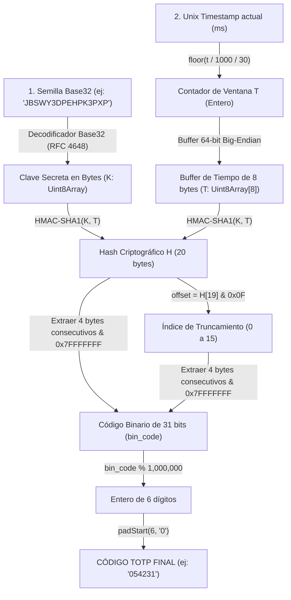

# PLAN ARQUITECTÓNICO: MÓDULO AUTHENTICATOR PROPIO — TOTP EN MODO AVIÓN
**Código:** PLAN-004 | **Especificación:** SPEC-004 | **Estado:** Aprobado

---

## 1. DISEÑO MATEMÁTICO DEL ALGORITMO TOTP (RFC 6238)



---

## 2. DETALLE DE OPERACIONES MATEMÁTICAS A IMPLEMENTAR

### 2.1. Decodificador Base32 (RFC 4648)
- El alfabeto contiene 32 símbolos: `A-Z` (valores 0–25) y `2-7` (valores 26–31).
- Cada carácter contiene **5 bits** de información útil.
- Los bits se van acumulando en un buffer de enteros (`bitsBuffer = (bitsBuffer << 5) | valor`).
- Cada vez que se acumulan $\ge 8$ bits, se extrae el byte superior (`byte = (bitsBuffer >>> (bitsCount - 8)) & 0xFF`) y se resta 8 al contador.

### 2.2. Empaquetado Big-Endian de 64 bits (8 bytes)
El estándar RFC 4226 / RFC 6238 exige que el contador de pasos de tiempo $T$ viaje como un entero de 64 bits en orden de byte más significativo primero (Big-Endian):
```text
Byte 0: (T >>> 56) & 0xFF (siempre 0 para fechas actuales)
Byte 1: (T >>> 48) & 0xFF
Byte 2: (T >>> 40) & 0xFF
Byte 3: (T >>> 32) & 0xFF
Byte 4: (T >>> 24) & 0xFF
Byte 5: (T >>> 16) & 0xFF
Byte 6: (T >>> 8)  & 0xFF
Byte 7: T & 0xFF
```
En JavaScript, dado que `BigInt` soporta 64 bits nativamente, se puede escribir de forma exacta y elegante mediante un `DataView` con `dataView.setBigUint64(0, BigInt(T), false)` (`false` = Big-Endian).

### 2.3. Dynamic Truncation (Truncamiento Dinámico)
- El hash HMAC-SHA1 produce un digest de exactamente 20 bytes: $H[0 \dots 19]$.
- Se toma el nibble inferior del último byte: $\text{offset} = H[19] \& 0x0F$ (valor entre 0 y 15).
- Se toman 4 bytes a partir de $\text{offset}$ y se descarta el bit de signo más significativo (MSB) con la máscara `0x7F`:
  $$\text{bin\_code} = ((H[\text{offset}] \& 0x7F) \ll 24) \mid ((H[\text{offset}+1] \& 0xFF) \ll 16) \mid ((H[\text{offset}+2] \& 0xFF) \ll 8) \mid (H[\text{offset}+3] \& 0xFF)$$
- Se calcula: $\text{TOTP} = (\text{bin\_code} \pmod{1000000})\text{.toString().padStart(6, '0')}$.

---

## 3. ARCHIVOS A CREAR Y MODIFICAR
- `mobile-app/src/crypto/base32.ts`: Decodificador Base32 puro según RFC 4648.
- `mobile-app/src/crypto/totp.ts`: Motor matemático TOTP (cálculo de $T$, buffer de 64 bits, HMAC-SHA1 y Dynamic Truncation).
- `mobile-app/src/screens/TotpScreen.tsx`: Conectar el motor real a la UI con temporizador visual, actualización cada segundo y campo de edición de semilla.
- `backend-auth/src/services/totpValidator.ts`: Implementar la misma lógica en backend para validar códigos en ventanas $C-1, C, C+1$.
- `backend-auth/src/tests/totp.test.ts`: Pruebas de paridad con vectores oficiales del RFC 6238 y comparación con Google Authenticator.

