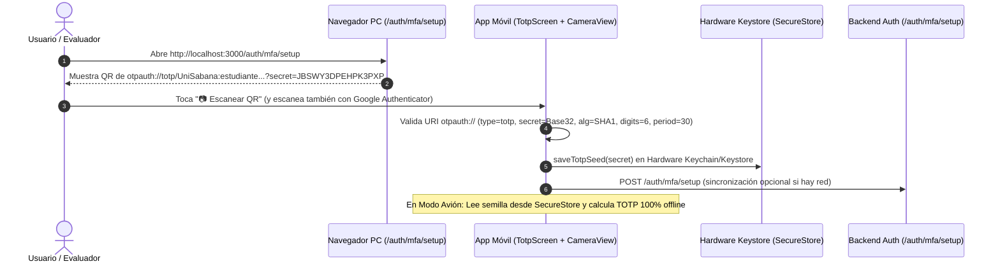

# PLAN ARQUITECTÓNICO: CONFIGURACIÓN Y APROVISIONAMIENTO DEL SECRETO TOTP
**Código:** PLAN-005 | **Especificación:** SPEC-005 | **Estado:** Aprobado

---

## 1. FLUJO DE APROVISIONAMIENTO Y PERSISTENCIA SEGURA

---

## 2. COMPONENTES Y ARCHIVOS INVOLUCRADOS

### En `mobile-app`:
- `package.json`: Instalar `expo-camera` mediante `npx expo install expo-camera`.
- `src/crypto/base32.ts`: Ampliar `parseTotpInput()` para validar estrictamente el formato `otpauth://totp/`, `secret`, `issuer`, `algorithm` (`SHA1`), `digits` (`6`) y `period` (`30`).
- `src/services/secureStorageService.ts`: Añadir `saveTotpSeed()`, `getTotpSeed()` y ` saveTotpIssuer()`.
- `src/screens/TotpScreen.tsx`:
  - Cargar semilla persistida en `SecureStore` al montar la pantalla.
  - Modal con `CameraView` (`expo-camera`) para escanear QR `otpauth://`.
  - Botón para persistir cambios manuales de semilla en `SecureStore` y sincronizar con el backend.

### En `backend-auth`:
- `src/services/totpValidator.ts`: Mapa en memoria `userTotpSecretsStore` (`userId -> secretBase32`) inicializado con `JBSWY3DPEHPK3PXP` y funciones `getUserTotpSecret()` / `setUserTotpSecret()`.
- `src/routes/authRoutes.ts`:
  - `GET /auth/mfa/setup`: Devuelve JSON o renderiza la página HTML de aprovisionamiento con el QR de la URI `otpauth://` oficial.
  - `POST /auth/mfa/setup`: Actualiza la semilla TOTP del usuario en memoria tras validar que sea Base32 válido.
- `src/tests/totp.test.ts`: Añadir pruebas de validación estricta de URIs `otpauth://` (aceptación de URI válida y rechazo de `digits=8`, `period=60`, `algorithm=SHA256` o `otpauth://hotp/`).
