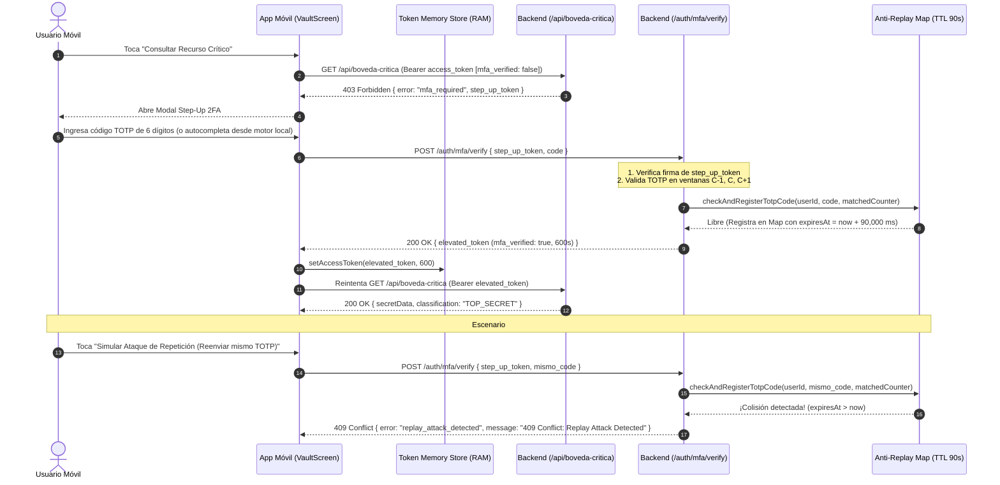

# PLAN ARQUITECTÓNICO: STEP-UP AUTHENTICATION Y CACHÉ ANTI-REPLAY
**Código:** PLAN-007 | **Especificación:** SPEC-007 | **Estado:** Aprobado

---

## 1. DIAGRAMA DE SECUENCIA: STEP-UP 2FA Y BLOQUEO ANTI-REPLAY

---

## 2. COMPONENTES Y ARCHIVOS INVOLUCRADOS

### En `backend-auth`:
- `src/services/antiReplayService.ts`:
  - `Map<string, number>` en memoria con clave compuesta `${userId}:${counter}:${code}` y valor `expiresAt = Date.now() + 90_000`.
  - Purga automática de entradas vencidas y verificación atómica sincrónica.
- `src/routes/apiRoutes.ts`:
  - `GET /api/boveda-critica` y alias `GET /api/boveda`: protegidos por `requireAccessToken`. Si `!req.user.mfa_verified`, emite `step_up_token` y responde `403 Forbidden`. Si `req.user.mfa_verified === true`, devuelve `VaultData`.
- `src/routes/authRoutes.ts`:
  - `POST /auth/mfa/verify`: valida `step_up_token`, verifica TOTP en `C-1, C, C+1`, consulta `antiReplayService` (`409 Conflict` si ya fue usado) y emite `elevated_token` (`mfa_verified: true`, `expires_in: 600`).
- `src/tests/stepUpAntiReplay.test.ts`:
  - Batería de pruebas automatizadas para el Punto 4 (`403 Forbidden`, elevación `200 OK` con `mfa_verified: true`, acceso a bóveda y rechazo `409 Conflict` ante código repetido).

### En `mobile-app`:
- `src/screens/VaultScreen.tsx` y `App.tsx`:
  - Conectar con `apiFetch('/api/boveda-critica')`.
  - Capturar `403 Forbidden`, guardar `step_up_token` y abrir el modal de 2FA.
  - Permitir ingresar el código TOTP (con botón opcional de lectura rápida del TOTP local para agilidad en la sustentación de 5 minutos).
  - Actualizar el token en `tokenMemoryStore` con el `elevated_token` (10 min), notificar a `App.tsx` (`mfaVerified: true`) y cargar los datos reales de la bóveda.
  - Incluir botón demostrativo **"🛡️ Probar Ataque de Repetición (Reenviar Código Usado)"** para demostrar en vivo el `409 Conflict` (Escenario #5 de la sustentación).

